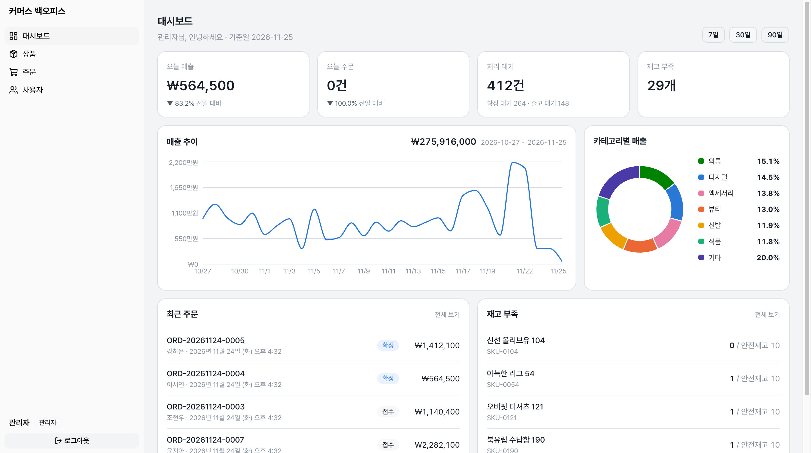
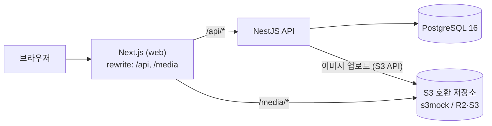
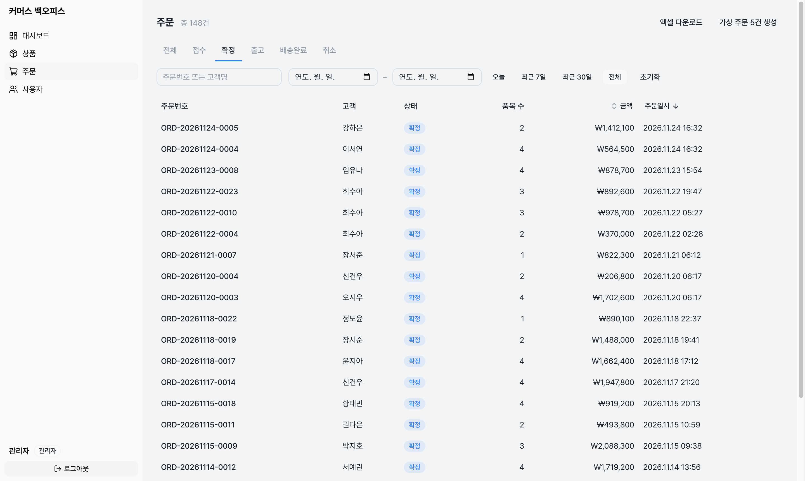
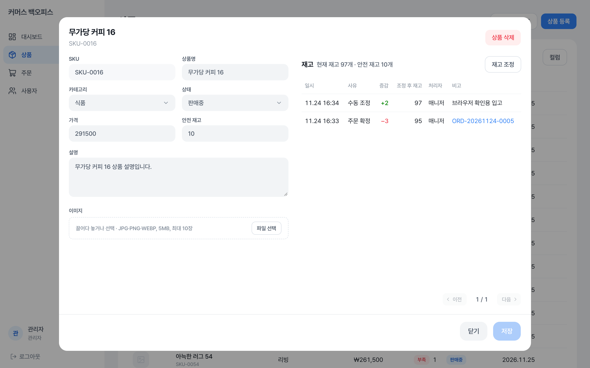
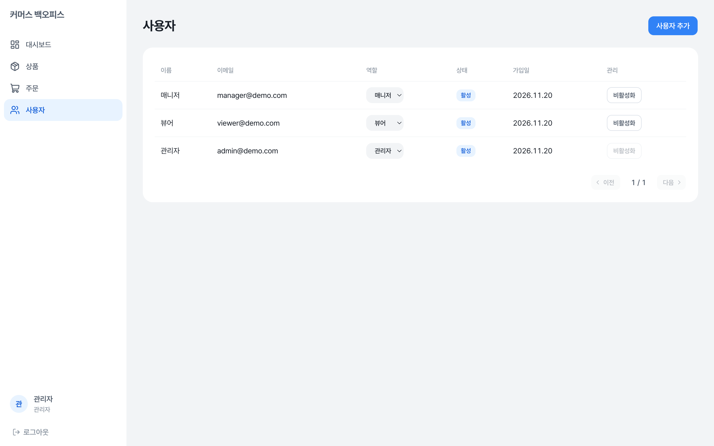

# Commerce Back-office

이커머스 운영자를 위한 백오피스다. 상품·주문·재고·사용자를 관리하고 대시보드로 매출을 본다. 화면만 있는 목업이 아니라 API 서버가 끝까지 동작하며, 인증·권한·페이지네이션·트랜잭션을 테스트로 증명한다.

- 데모: 배포 후 추가



## 아키텍처



브라우저는 Next 도메인만 상대한다. Next가 `/api/*`는 API로, `/media/*`는 오브젝트 스토리지로 rewrite하므로 인증 쿠키는 1st-party 쿠키로 저장된다.

## 기술 스택

- 모노레포: pnpm workspace (Node 24)
- API: NestJS 12 (ESM), TypeORM, PostgreSQL 16, Vitest + Testcontainers
- Web: Next.js 16, Tailwind CSS, Radix·shadcn/ui
- 공용 계약: `@bo/contracts` (API·Web이 함께 쓰는 TS 타입·enum, tsup 빌드)
- 저장소: S3 호환 오브젝트 스토리지 (로컬 s3mock / 배포 R2·S3)
- 인프라: docker compose (PostgreSQL, s3mock)
- CI: GitHub Actions

## 로컬 실행

사전 준비: Node 24, pnpm 10, Docker.

```bash
# 1. 환경 변수 준비
cp .env.example .env

# 2. 의존성 설치
pnpm install

# 3. DB·스토리지 기동, 마이그레이션, 시드 (스토리지는 이미지 업로드에만 필요하다. 시드에는 필요 없다)
pnpm db:up:storage && pnpm db:migrate && pnpm db:seed
# 시드 주문(1,500건)은 재고와 재고 이력에 반영되지 않는다.

# 4. 개발 서버 (web :3000, api :4000)
pnpm dev
```

`http://localhost:3000`에서 아래 데모 계정으로 로그인할 수 있다.

> `pnpm db:up`은 PostgreSQL만, `pnpm db:up:storage`는 PostgreSQL과 s3mock(`adobe/s3mock`, 호스트 포트 9090, 버킷 `bo-media`)을 띄우고 헬스체크가 통과할 때까지 기다린 뒤 반환한다. 상품 이미지 업로드는 스토리지가 있어야 동작한다. 처음에는 MinIO를 썼으나 이미지를 더 이상 받을 수 없어 s3mock으로 바꿨다.

> 이미지는 Web의 `/media/*` 요청을 `MEDIA_ORIGIN`(기본 `http://localhost:9090/bo-media`)으로 rewrite해 제공한다. s3mock 호스트 포트는 `S3MOCK_PORT`로 바꿀 수 있고, 바꾸면 `S3_ENDPOINT`와 `MEDIA_ORIGIN`도 함께 바꾼다.

> PostgreSQL 호스트 포트는 로컬 Postgres(5432)와 겹치지 않도록 **5433**(`PG_PORT`)을 쓴다. 포트를 바꾸면 `.env`의 `DATABASE_URL`도 함께 바꾼다.

### 데모 계정

| 이메일           | 역할    | 비밀번호    |
| ---------------- | ------- | ----------- |
| admin@demo.com   | ADMIN   | `demo1234!` |
| manager@demo.com | MANAGER | `demo1234!` |
| viewer@demo.com  | VIEWER  | `demo1234!` |

비밀번호는 `.env`의 `SEED_PASSWORD`로 바꿀 수 있다. 로그인 화면의 데모 계정 버튼은 고정 비밀번호 `demo1234!`를 쓰므로, 이를 바꾸면 버튼 로그인은 실패한다(기본 `SEED_PASSWORD`와 일치).

> Web의 rewrite 대상인 `API_ORIGIN`(`/api/*`)과 `MEDIA_ORIGIN`(`/media/*`)은 Next가 `apps/web/.env*` 또는 프로세스 환경 변수에서 읽는다. 루트 `.env`는 Next가 로드하지 않는다(`.env.example`의 두 값은 참고용이다). rewrite는 `next.config.ts`가 평가될 때(`next dev` 시작, `next build`) 정해지므로 값을 바꾸면 Web을 다시 시작(프로덕션은 다시 빌드)해야 한다. 기본값이 로컬 환경과 일치하므로 보통 설정할 필요가 없다.

## 주요 스크립트

| 명령                 | 설명                                         |
| -------------------- | -------------------------------------------- |
| `pnpm dev`           | contracts 빌드 후 api·web 개발 서버 실행     |
| `pnpm build`         | 전체 워크스페이스 빌드                       |
| `pnpm lint`          | 전체 린트                                    |
| `pnpm typecheck`     | 전체 타입 검사                               |
| `pnpm test`          | 단위 테스트                                  |
| `pnpm test:e2e`      | API e2e 테스트 (Testcontainers, Docker 필요) |
| `pnpm db:up`         | docker compose로 PostgreSQL 기동             |
| `pnpm db:up:storage` | s3mock까지 함께 기동 (이미지 업로드에 필요)  |
| `pnpm db:migrate`    | DB 마이그레이션 적용(API 빌드 포함)          |
| `pnpm db:seed`       | 데모 계정 시드(API 빌드 포함)                |
| `pnpm format`        | Prettier 포맷 적용                           |
| `pnpm format:check`  | 포맷 검사 (CI에서 사용)                      |

## 주요 기능

### 인증·권한

- 로그인·로그아웃과 access·refresh 토큰 갱신. 토큰은 httpOnly 쿠키에만 두고 JS에서 다루지 않는다.
- 역할은 ADMIN ⊃ MANAGER ⊃ VIEWER다. 권한은 서버가 강제하고 화면의 노출 제어는 UX일 뿐이다.
- 로그인 시도 제한: `POST /auth/login`을 IP와 이메일 조합별로 센다. 한도를 넘으면 429 `TOO_MANY_REQUESTS`와 `Retry-After`를 돌려준다(`LOGIN_THROTTLE_LIMIT`, `LOGIN_THROTTLE_TTL_SEC`, 프록시 뒤에서는 `TRUST_PROXY`).

### 상품·이미지

- 상품 목록: 필터·정렬·페이지를 URL 쿼리와 동기화해 새로고침해도 유지된다. 검색은 Enter나 검색 버튼을 눌렀을 때만 요청한다.
- 상품 등록·상세는 목록 위 모달이다. 상세는 `?detail=<id>`로 열려 새로고침·링크 공유에도 유지되고, 넓은 화면에서는 왼쪽에 기본 정보·이미지를, 오른쪽에 재고(5개씩 페이징)를 스크롤 없이 보여 준다. 닫기·취소·저장은 스크롤되지 않는 하단에 있다.
- 상품 등록·수정·삭제 (역할별 권한 적용, 뷰어는 읽기 전용).
- 이미지 업로드·리사이즈: 업로드한 이미지를 WebP로 변환해 저장하고 `/media/{key}`로 제공한다.

### 주문·재고

- 주문 목록: 상태 탭, 달력(shadcn Calendar, 오늘 이후 날짜는 선택 불가)과 KST 기간 프리셋(오늘·7일·30일), 주문번호·고객 검색을 URL 쿼리와 동기화한다. 개발 편의용 가상 주문 생성 버튼이 있다.
- 주문 상세: 품목, 상태 타임라인, 상태 전이(확정·배송·완료·취소). 전이는 한 트랜잭션에서 주문 행과 재고를 함께 바꾼다. 재고가 부족하면 품목별로 안내하고(422), 다른 사용자가 먼저 상태를 바꿨으면 충돌 안내(409)를 보여 준다.
- 재고: 상품 화면에서 입고·출고로 재고를 수동 조정하고, 모든 재고 변동(주문 확정·취소, 수동 조정)을 이력으로 확인한다. 이력의 주문번호는 주문 상세로 연결된다.
- 삭제된 상품이 들어 있는 주문도 상세에서 상품명과 "삭제된 상품" 배지로 보인다(링크 없음).

### 대시보드

- KPI 카드 4개: 오늘 매출·오늘 주문·처리 대기·재고 부족. 오늘 매출과 오늘 주문은 전일 대비 증감률을 보이고, 전일 실적이 0이면 "전일 실적 없음"으로 표시한다.
  - 오늘 매출: `CONFIRMED`·`SHIPPED`·`DELIVERED` 주문의 합계를 확정 시각(`confirmedAt`) 기준 KST 날짜로 센다. `PENDING`과 확정 후 취소된 주문은 빠진다.
  - 오늘 주문: 오늘(KST) 접수(`createdAt`)된 주문 수. 상태는 가리지 않는다(취소 포함).
  - 처리 대기: 확정 대기(`PENDING`)와 출고 대기(`CONFIRMED`)의 합계를 큰 숫자로 보이고 그 아래에 "확정 대기 N · 출고 대기 N" 내역을 보인다. 내역은 각각 `/orders?status=PENDING`·`/orders?status=CONFIRMED`로 연결된다. 기간과 무관한 현재 상태다.
  - 재고 부족: 안전 재고 이하이고 삭제되지 않은 상품 수. 상품 목록의 `lowStock=true`와 같은 조건이라 카드를 누르면 같은 숫자의 목록으로 간다.
- 매출 추이 라인차트와 카테고리별 매출 도넛. 기간 토글(7일·30일·90일)은 `?days=`로 URL에 남는다. 매출 없는 날도 0으로 채운다. 매출이 있는 카테고리가 6개를 넘으면 상위 6개와 "기타"로 묶는다.
- 최근 주문 5건과 재고 부족 상품 5건.
- API: `GET /api/v1/dashboard/summary`, `/dashboard/sales-trend?days=`, `/dashboard/category-sales?days=` (`days`는 7·30·90, 기본 30. 모두 VIEWER 이상).

### 엑셀 다운로드

- 상품 목록과 주문 목록에서 현재 필터·정렬 그대로 `.xlsx`로 내려받는다. 화면의 "엑셀 다운로드" 버튼이고, 매니저 이상에게만 보인다.
- API: `GET /api/v1/products/export`, `GET /api/v1/orders/export`. MANAGER 이상(VIEWER는 403, 비로그인은 401)이다. 쿼리는 목록 API와 같고 `page`·`size`는 무시한다.
- 한 번에 최대 10,000행이다. 필터 결과가 이를 넘으면 파일을 쓰기 전에 422 `EXPORT_TOO_LARGE`를 돌려주고 화면은 필터를 좁히라고 안내한다. 0행이면 헤더만 있는 파일이 내려온다.
- 파일 형식: 시트 이름은 `상품`·`주문`이고, 1행은 굵은 헤더로 틀 고정한다. 금액은 숫자 셀에 `#,##0` 형식이고, 시각은 KST `YYYY-MM-DD HH:mm` 문자열이다. 상품명·고객명 같은 사용자 입력은 항상 문자열 셀이라 `=`로 시작해도 수식이 되지 않는다.
- 파일명은 `상품목록_YYYYMMDD.xlsx`·`주문목록_YYYYMMDD.xlsx`(KST 날짜)이고, 한글 이름은 `Content-Disposition`의 RFC 5987 `filename*`로 전달한다.

### 사용자 관리

- ADMIN이 사용자 목록을 보고 사용자를 추가(`POST /api/v1/users`)하고, 역할·활성 상태·이름을 바꾼다(`PATCH /api/v1/users/:id`). 비활성화는 확인 다이얼로그를 거친다.
- 본인의 역할·활성 상태는 바꿀 수 없다(409 `SELF_CHANGE`). 화면은 본인 행의 컨트롤을 비활성화한다.
- 마지막 활성 ADMIN을 강등하거나 비활성화하는 변경은 막는다(409 `LAST_ADMIN`).
- 사용자를 비활성화하면 그 사용자의 미폐기 refresh 토큰을 같은 트랜잭션에서 폐기한다. 매 요청 DB에서 사용자를 다시 읽으므로 남은 access 토큰도 즉시 401이 된다.
- 이메일이 이미 있으면 409 `EMAIL_TAKEN`이다.

### 기타

- UI: 토스 UI를 참고한 디자인(회색 바탕 위 흰 시트, 넉넉한 크기, 누를 수 있는 요소의 pointer cursor). Tailwind·Radix·shadcn만 쓴다.
- 데이터를 불러오는 동안 실제 모양을 닮은 스켈레톤을 보여 주고, 등록·저장·삭제 등이 끝나면 토스트로 알린다.
- 고아 이미지 정리: 매일 04:00(KST)에 크론이 지운다. 대상은 24시간 넘게 상품에 연결되지 않은 이미지(저장하지 않은 업로드와 상품에서 떼어낸 이미지)와, 소프트 삭제된 지 24시간이 넘은 상품의 이미지다.
- 화면의 오류 문구는 `errorMessage`가 에러 코드로 정하는 한국어다. 서버의 영어 `message`는 개발자용이다.
- Swagger(`/api/docs`)는 태그별로 묶여 있고 `/dev/*`는 빠져 있다. 공통 에러 응답은 `ApiErrorBody` 스키마다.

## 공개 데모

- 데모 데이터는 모든 방문자가 함께 쓰고 누구나 고칠 수 있다. 상품·주문을 바꾸면 다른 방문자에게도 그대로 보인다.
- `DEMO_MODE=true`이면 시드 데모 계정 3개(`admin@demo.com`·`manager@demo.com`·`viewer@demo.com`)는 이름을 포함해 어떤 변경도 403 `DEMO_PROTECTED`로 막힌다.
- `DEMO_MODE=true`일 때 사용자 수가 20명(`DEMO_MAX_USERS`)에 이르면 사용자 추가가 403 `DEMO_PROTECTED`로 막힌다.
- 로그인 시도 제한이 켜져 있다. 프록시 뒤에서는 `TRUST_PROXY`로 신뢰할 홉 수를 맞춰야 한다.
- 데모 비밀번호는 위 [데모 계정](#데모-계정)과 같다.
- 무료 플랜(Vercel Hobby, Render Free, Neon Free)으로 배포한다. 기본 구성에서는 상품 이미지 업로드를 쓰지 않고, api가 15분간 요청이 없으면 잠들어 첫 접속이 느리다.
- 배포 절차, 선택 사항인 이미지 저장소(R2) 연결, `TRUST_PROXY` 확인 방법은 [docs/deploy.md](docs/deploy.md)에 있다.

## 스크린샷

| 주문 목록                            | 상품 상세 모달                                    |
| ------------------------------------ | ------------------------------------------------- |
|  |  |



## 설계 문서

[docs/2026-11-20-commerce-backoffice-design.md](docs/2026-11-20-commerce-backoffice-design.md)

## 설계 결정

- 이미지는 업로드 후 미연결 상태로 저장했다가 상품 저장 시 트랜잭션으로 연결한다.
- 주문 확정은 비관적 락으로 처리한다. 재고 행을 productId 순으로 `FOR UPDATE` 잠근다. 낙관적 락(`@VersionColumn`)과 비교하면, 충돌이 잦은 인기 상품에서 재시도가 폭주하는 대신 짧게 기다리고 잠금 순서를 고정해 교착을 막는다.
- 재고 변경은 `InventoryLedger` 한 곳에서만 한다. 이력 누락을 구조적으로 막는다.
- 상품 수정은 `FOR NO KEY UPDATE`로 잠근다. 재고 이력·주문 품목의 외래 키 확인(`FOR KEY SHARE`)과 충돌하지 않게 해 주문 확정과의 교착을 막는다(동시 실험에서 재현 후 수정, 결정적 회귀 테스트 포함).
- 감수한 트레이드오프: 두 탭이 같은 refresh 토큰으로 동시에 갱신하면 늦은 쪽 요청은 재사용으로 간주되어 토큰 패밀리 전체가 폐기되고 인증 쿠키 두 개가 모두 삭제된다. 진 탭은 즉시 `/login?reason=expired`로 이동하고, 쿠키는 탭끼리 공유되므로 다른 탭도 다음 요청·이동 때 로그인 화면으로 보내진다. 리다이렉트 루프는 생기지 않는다. 짧은 유예 구간(grace window)으로 나중에 완화할 수 있다.
- 매출은 확정 시각(`confirmedAt`) 기준, KST 날짜 버킷이다. 접수가 아니라 확정이 매출이고, 확정 후 취소는 빠진다. 시각은 `CLOCK`으로 주입해 자정 경계를 테스트로 고정했다.
- 재고 부족·최근 주문은 전용 API 없이 목록 API(`/orders?size=5`, `/products?lowStock=true`)를 재사용한다. 대시보드와 목록의 숫자가 갈라지지 않게 하려는 것이다.
- 엑셀은 목록과 같은 DTO·쿼리 빌더를 재사용한다. 화면에 보이는 그대로 내려받고, 필터 로직이 두 벌로 갈라지지 않게 하려는 것이다. e2e가 목록 전체 페이지와 파일을 행 단위로 대조한다.
- 엑셀은 exceljs 스트리밍과 REPEATABLE READ 스냅샷으로 만든다(`common/xlsx/stream-export.ts`). 1,000행씩 읽어 바로 쓰고 건수 확인과 파일 내용이 같은 시점을 본다. 한도 초과는 바이트를 쓰기 전에 422로 막는다. 트랜잭션은 마지막 배치를 읽으면 바로 끝나 전송이 느려도 커넥션을 붙잡지 않고, 클라이언트가 중간에 끊으면 읽기를 멈추고 트랜잭션을 끝내 커넥션을 풀에 돌려준다.
- 마지막 관리자 보호는 서버 트랜잭션에서 ADMIN 행을 잠가 판정한다. 두 관리자가 동시에 서로를 강등해도 한쪽만 성공하고, 활성 ADMIN이 0명이 되지 않는다.
- 고아 이미지는 DB 삭제를 커밋한 뒤 스토리지를 지운다. 스토리지 삭제가 실패해도 깨진 참조 대신 고아 오브젝트만 남는다.
- 상품에서 떼어낸 이미지의 24시간은 업로드 시각(`createdAt`) 기준으로 센다. 떼어낸 시점 기준이 아니라서 오래전에 올린 이미지는 떼어낸 뒤 다음 정리 때 바로 지워질 수 있다. 알고 있는 단순화다.
